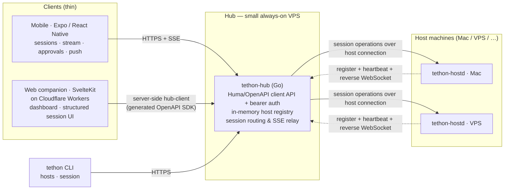
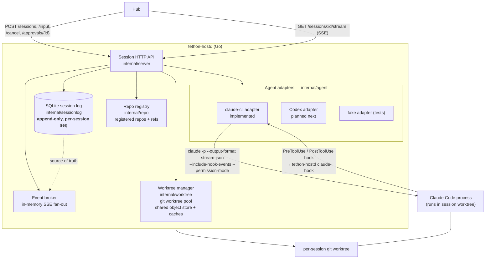
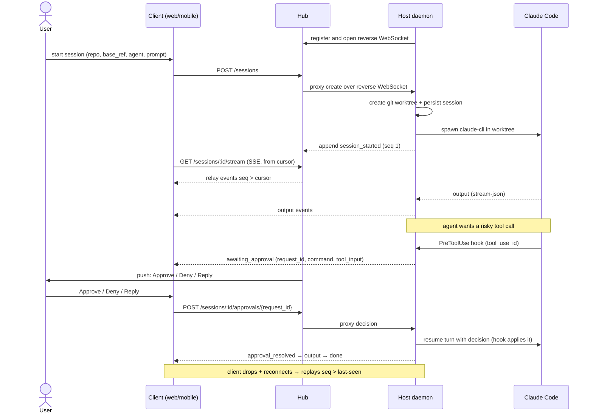

# Tethon

Run coding agents on your own machines from a phone or browser. Tethon starts isolated sessions across registered repositories, streams structured agent events, and lets you send input or resolve tool approvals without staying at the host machine.

Tethon is not a remote desktop. It is an agent control plane with an adapter boundary for different coding agents. The clients understand sessions, tool calls, approvals, usage, and reconnectable event streams. Claude Code is the first working adapter. Codex is next on the adapter roadmap.

## Current state

Tethon is an early, self-hosted project that I currently use for remote Claude Code sessions. The control-plane protocol and host architecture are designed for multiple agent adapters, with Codex planned next. The Go control plane, web companion, and Expo mobile client are runnable. The mobile client can connect to a hub, list and start sessions, stream and persist events, send follow-up input, stop or delete sessions, resolve approvals, and act on approval push notifications.

The project is under active development. Read [known limitations](kb/known-limitations.md) before exposing a deployment outside a private network.

## Quick start

The current happy path uses the Claude Code adapter with a deployed hub, a macOS host daemon, and either the web or mobile client. Start with [First remote agent session](kb/first-remote-agent-session.md). It covers the required token, hub checks, host installation, client setup, and a first isolated session.

For local development:

```sh
bun install

cd control && go test ./...
cd ../web && bun run check && bun run lint
cd ../mobile && bun run lint
```

## Architecture

Three tiers: thin **clients**, an always-on **hub** that is the single authentication and routing surface, and one **host daemon** per machine that owns session state and runs the agent. Host daemons dial out and keep a WebSocket open to the hub. Clients only talk to the hub.

### System topology



### Host daemon internals

Each `tethon-hostd` is the source of truth for its sessions. It runs two HTTP listeners (a session API the hub proxies to, and a local `/healthz` + `/status` health endpoint), supervises agent processes, and persists every event.



### Session lifecycle & approval flow

The wire contract is an **append-only event log per session with a cursor** (`internal/protocol`). Clients reconnect with "I'm at event N" and the daemon replays `seq > N` — so a dropped mobile connection never loses agent output. Event types: `session_started`, `output`, `tool_result`, `awaiting_approval`, `approval_resolved`, `input_received`, `usage`, `done`, `error`.

Approvals bind to a specific tool call via Claude Code's `PreToolUse` hook: the daemon holds the pending state (it is the source of truth), the client only sends the decision.



### Components

- **Host daemon** (`tethon-hostd`, Go): one per machine. It owns session state, manages a git worktree pool, supervises agent processes through adapters, emits structured events, and keeps an outbound connection to the hub. The SQLite log is the source of truth; an in-memory broker handles live fan-out to attached clients. Claude Code is implemented now, with Codex planned next.
- **Hub** (`tethon-hub`, Go): an always-on coordinator with a Huma/OpenAPI API, bearer-token authentication, host routing, SSE relay, and mobile push delivery. Host registrations are in memory; mobile device registrations are stored in SQLite.
- **Web companion** (SvelteKit on Cloudflare Workers): a dashboard and structured session UI. A server-side client generated from the hub OpenAPI schema talks to the hub.
- **Mobile client** (Expo / React Native): connects with credentials stored in SecureStore; lists and starts sessions; persists and resumes event streams; sends input; resolves approvals; and handles approval push notifications.
- **CLI** (`tethon`): `hosts` and `session` subcommands that drive the hub directly. `tethon-openapi` emits the schema used to generate the web and mobile SDK.

The host daemon's HTTP listener is for local diagnostics. Session operations travel through the outbound WebSocket, so the hub does not need inbound network access to the host machine.

## Status

Early but runnable through the hub, host daemon, CLI, web companion, and mobile client.

Implemented now:

- Go hub, host daemon, and CLI under `control/`
- SQLite-backed append-only session/event log with cursor replay
- host registration, heartbeat, host/session relay, and bearer-token auth
- host-initiated reverse WebSocket for session operations
- hub `/healthz`, hostd `/healthz` and `/status`, plus a macOS hostd doctor
- `claude-cli` adapter using the local Claude Code CLI and subscription auth
- per-session git worktrees with cleanup guardrails and shared build/dependency caches
- SvelteKit web UI for hosts, session creation, session list/detail, structured stream, input, approvals, and basic usage display
- Expo mobile client for connection setup, host and session views, session creation, persisted event streams, input, lifecycle actions, and approvals
- Expo push registration and approve, deny, or reply actions from notifications
- macOS LaunchAgent install/run script for `tethon-hostd`
- Dokploy/Compose hub deployment path

Not implemented yet:

- Codex and additional agent adapters
- raw PTY/xterm escape hatch
- persistent hub registry
- `caffeinate` while sessions are active

## Security model

Tethon can start coding agents and approve tool calls on registered machines. Treat the hub token as a powerful credential.

- Keep tokens in environment secrets or the mobile secure store. Do not commit them.
- Put the hub behind HTTPS.
- Bind the host daemon diagnostics listener to a local or private interface.
- Use the outbound host connection instead of exposing the host daemon publicly.
- Review the current [limitations](kb/known-limitations.md) before relying on Tethon outside a personal or trusted-team deployment.

## Repo

- `control/` — Go control plane: hub, host daemon, CLI, protocol, agent adapters, session log, repo/worktree management
- `web/` — SvelteKit companion app
- `mobile/` — Expo mobile client
- `deploy/hub/` — Dokploy/Compose hub deployment
- `scripts/` — host install/run and project scripts
- `kb/` — design brief, roadmap, runbooks, research, and limitations — start with [`kb/agent-control-design.md`](kb/agent-control-design.md)
- [`kb/first-remote-agent-session.md`](kb/first-remote-agent-session.md) — current happy path from install to first remote `claude-cli` session
- [`kb/hub-deploy-dokploy.md`](kb/hub-deploy-dokploy.md) — preferred Dokploy deployment path for `hub.tethon.dev`
- [`kb/macos-host-daemon.md`](kb/macos-host-daemon.md) — macOS install/run story for `tethon-hostd`
- [`kb/known-limitations.md`](kb/known-limitations.md) — current gaps and caveats

## License

Tethon is available under the [MIT License](LICENSE).
