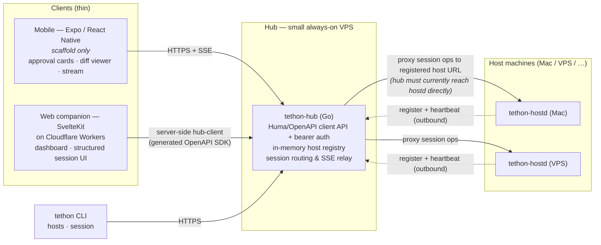
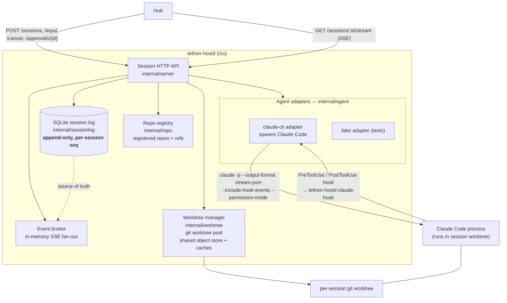
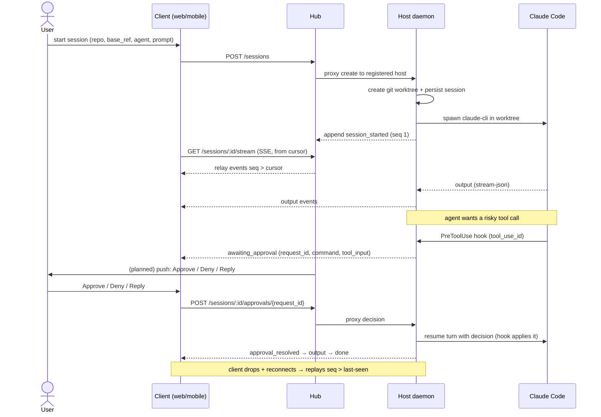

# tethon

Run coding agents (Claude Code, Codex, etc.) intensively, from anywhere — without being at the Mac. Spin up agents on demand across repos and host machines, and drive them from your phone with first-class ergonomics. A web companion acts as a secondary screen.

It's not a remote desktop. It's a purpose-built **agent control** experience: structured UI for the common case, raw terminal as an escape hatch, and push-notification approvals that work from the lock screen.

## Architecture

Three tiers: thin **clients**, an always-on **hub** that is the single auth + routing surface, and one **host daemon** per machine that owns all session state and runs the agents. Host daemons dial out to the hub to register; clients only ever talk to the hub.

### System topology

### Host daemon internals

Each `tethon-hostd` is the source of truth for its sessions. It runs two HTTP listeners (a session API the hub proxies to, and a local `/healthz` + `/status` health endpoint), supervises agent processes, and persists every event.

### Session lifecycle & approval flow

The wire contract is an **append-only event log per session with a cursor** (`internal/protocol`). Clients reconnect with "I'm at event N" and the daemon replays `seq > N` — so a dropped mobile connection never loses agent output. Event types: `session_started`, `output`, `tool_result`, `awaiting_approval`, `approval_resolved`, `input_received`, `usage`, `done`, `error`.

Approvals bind to a specific tool call via Claude Code's `PreToolUse` hook: the daemon holds the pending state (it is the source of truth), the client only sends the decision.

### Components

- **Host daemon** (`tethon-hostd`, Go) — one per machine; owns session state, manages a git worktree pool, supervises agents, emits structured events, and registers/heartbeats with the hub. The SQLite log is the source of truth; an in-memory broker is only live fan-out to attached clients.
- **Hub** (`tethon-hub`, Go) — always-on coordinator on a small VPS; in-memory host registry + routing + SSE relay, with a Huma/OpenAPI client-facing API behind bearer-token auth. Single auth surface for all clients.
- **Web companion** (SvelteKit on Cloudflare Workers) — dashboard and structured session UI. A server-side hub client (generated from the hub's OpenAPI schema) talks to the hub; raw terminal is still planned.
- **Mobile client** (Expo / React Native) — the primary surface target: approval cards, diff viewer, agent stream. The current app is only scaffolded.
- **CLI** (`tethon`) — `hosts` and `session` subcommands; drives the hub directly. `tethon-openapi` emits the hub OpenAPI schema that the web/mobile SDKs are generated from.

> **Routing caveat:** host daemons register and heartbeat *outbound*, but the hub still calls each registered host daemon URL to proxy session operations. Until host-initiated persistent connections land, the hub machine must be able to reach every `tethon-hostd` URL. See [`kb/known-limitations.md`](kb/known-limitations.md).

## Status

Early but runnable through the hub, host daemon, CLI, and web companion.

Implemented now:

- Go hub, host daemon, and CLI under `control/`
- SQLite-backed append-only session/event log with cursor replay
- host registration, heartbeat, host/session relay, and bearer-token auth
- hub `/healthz`, hostd `/healthz` and `/status`, plus a macOS hostd doctor
- `claude-cli` adapter using the local Claude Code CLI and subscription auth
- per-session git worktrees with cleanup guardrails and shared build/dependency caches
- SvelteKit web UI for hosts, session creation, session list/detail, structured stream, input, approvals, and basic usage display
- macOS LaunchAgent install/run script for `tethon-hostd`
- Dokploy/Compose hub deployment path

Not implemented yet:

- host-initiated persistent session tunnel; the hub still reaches the registered host daemon URL directly
- mobile workflow beyond the Expo scaffold
- push approvals
- raw PTY/xterm escape hatch
- persistent hub registry
- `caffeinate` while sessions are active

## Repo

- `control/` — Go control plane: hub, host daemon, CLI, protocol, agent adapters, session log, repo/worktree management
- `web/` — SvelteKit companion app
- `mobile/` — Expo scaffold
- `deploy/hub/` — Dokploy/Compose hub deployment
- `scripts/` — host install/run and project scripts
- `kb/` — design brief, roadmap, runbooks, research, and limitations — start with [`kb/agent-control-design.md`](kb/agent-control-design.md)
- [`kb/first-remote-agent-session.md`](kb/first-remote-agent-session.md) — current happy path from install to first remote `claude-cli` session
- [`kb/hub-deploy-dokploy.md`](kb/hub-deploy-dokploy.md) — preferred Dokploy deployment path for `hub.tethon.dev`
- [`kb/macos-host-daemon.md`](kb/macos-host-daemon.md) — macOS install/run story for `tethon-hostd`
- [`kb/known-limitations.md`](kb/known-limitations.md) — current gaps and caveats
